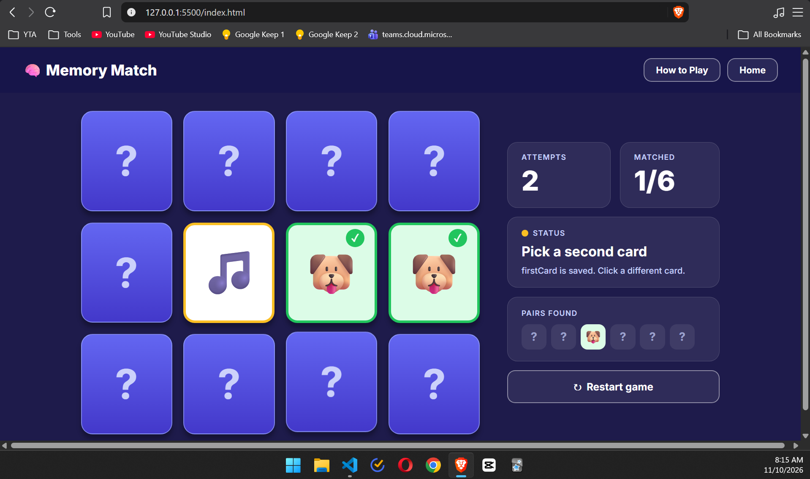
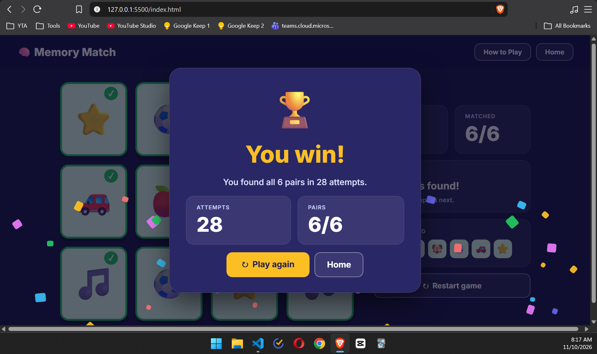

# Memory Match

A 4×3 Memory Matching Game made by **Group 7**.
Flip two cards at a time and find all 6 pairs. The layout follows our Figma design.

## Group Members

| Member | Work | Files |
|---|---|---|
| Cayabyab, Jayson M. (Member 1) | UI (HTML + CSS) | `index.html`, `css/style.css`, `css/animations.css` |
| Valdez, Jaypee V. (Member 2) | Card data and shuffle | `js/config.js`, `js/deck.js`, `js/shuffle.js` |
| Quitaleg, Frenz Jhonard R. (Member 3) | Click and match logic | `js/render.js`, `js/click.js`, `js/match.js` |
| Abalos, Andre M. | Score, win, reset, docs (Member 4)| `js/score.js`, `js/reset.js`, `README.md` |

## How to Play

1. Click **Play Game**.
2. Click a card to flip it face up.
3. Click a second card to look for its pair.
4. **Match:** both cards stay open. **No match:** they flip back after about 1 second.
5. Find all 6 pairs to win. Fewer attempts is a better score.

Clicks are ignored on: a third card while two are open, a matched card, and the same card twice.

## Data Structures Used

- **`cards`** — an array of 12 emoji strings (6 emojis × 2). Its position (index) is the card's identity.
- **`isMatched`** — an array of 12 `true/false` values, same positions as `cards`.
- **`EMOJIS`** — an array of the 6 card faces.
- Game state variables: `firstCard`, `secondCard` (indexes), `lockBoard`, `attempts`, `matchedPairs`.

## Algorithms Used

- **Fisher–Yates shuffle** (`shuffle.js`): walks from the last card to the second card, swaps each one with a random card at or before it. Every order has an equal chance (unbiased).
- **Comparison** (`match.js`): `cards[firstCard] === cards[secondCard]`.
- **Traversal** (`createDeck`, `renderBoard`, `updateScore`): loops over the arrays to build and draw things.

## Key Functions

| Function | File | Job |
|---|---|---|
| `createDeck()` | `deck.js` | Makes the array of pairs |
| `shuffle(array)` | `shuffle.js` | Fisher–Yates shuffle |
| `renderBoard()` | `render.js` | Draws the 12 cards |
| `flipCard(i)` / `unflipCard(i)` | `render.js` | Show or hide one card |
| `handleCardClick(index)` | `click.js` | Runs on a card click, blocks invalid clicks |
| `checkMatch()` | `match.js` | Compares the two cards |
| `clearPicks()` | `match.js` | Clears picks and unlocks the board |
| `updateScore()` | `score.js` | Updates attempts, matched, pairs found |
| `setStatus()` / `showToast()` | `score.js` | Status card and small warning messages |
| `checkWin()` | `score.js` | Opens the win popup when 6 pairs are found |
| `resetGame()` | `reset.js` | Restarts everything and reshuffles |
| `startGame()` | `reset.js` | Connects all buttons and starts the game |

## Script Load Order

`jQuery → config → shuffle → deck → render → match → score → click → reset`

## How to Launch

Open `index.html` in a browser. It needs internet for Bootstrap, jQuery, and the Inter font (CDN links).

## Screenshots
Starting screen: 
Mid-game: 
Win-popup: 